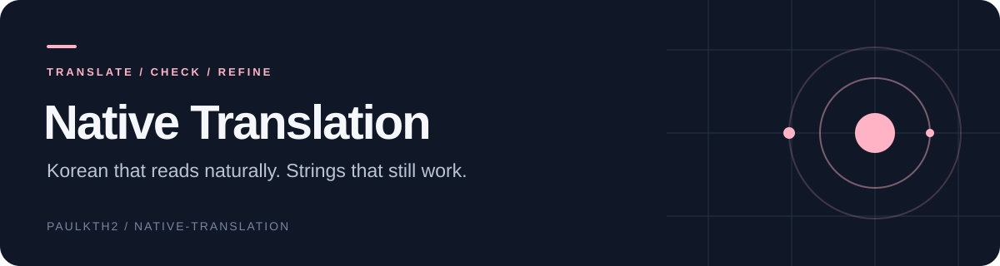
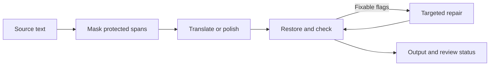

<div align="center">



**English-to-Korean translation and quality checks for product copy, UI strings, and technical documents.**


[Quick start](#quick-start) · [Pipeline](#how-the-pipeline-works) · [Plugin](#install-as-a-claude-code-plugin) · [Benchmark](#measure-on-your-own-strings)

</div>

Good localization needs more than fluent sentences. Placeholders must survive. Terminology must stay consistent. Korean particles must match the value inserted at runtime. Native Translation combines model-based translation with deterministic checks and targeted repairs for those practical constraints.

The core is a dependency-free Python CLI. You can also install its Korean translation skill in Claude Code and use the bundled benchmark harness to evaluate your own models and strings.

## Quick start

```sh
git clone https://github.com/paulkth2/native-translation.git
cd native-translation
```

Select an **HTTPS endpoint compatible with the Chat Completions request format** and a model available through that endpoint. Set `LLM_API_KEY` through your shell or secret manager, then configure the destination:

```sh
export LLM_ENDPOINT="https://YOUR_PROVIDER/v1/chat/completions"
export LLM_MODEL="YOUR_MODEL_ID"

python3 skills/korean-translation/translate.py \
  --register haeyo --fix "Sign in to continue"
```

The public export has no default service or model. You choose where text is sent. Endpoints must support the request fields used by the runner, including `messages`, `max_tokens`, and `temperature`.

For a network-free preview:

```sh
python3 skills/korean-translation/translate.py --dry-run "Delete {fileName}"
```

You can also copy `skills/korean-translation/config.example.json` to `config.local.json` in the same directory. Configuration files hold endpoint/model settings only; the runner reads the key from `LLM_API_KEY` or the gitignored `.api_key` file beside the script.

## How the pipeline works



| Capability | What it does |
|---|---|
| Protected spans | Masks code and URLs; polish mode also protects quoted text by default |
| Placeholder integrity | Checks placeholders, format specifiers, and selected structural markers |
| Terminology | Applies glossary and do-not-translate terms relevant to the segment |
| Korean style | Checks register, common translationese patterns, and selected naturalness signals |
| Targeted repair | Retries fixable failures within a bounded budget and keeps the best attempt |
| Review status | Surfaces remaining flags; `--strict` exits nonzero when flags remain |

Heuristics help catch mechanical failures. They do not prove semantic fidelity or native-level writing quality. Review ambiguous, literary, or consequential content with a Korean speaker.

## Everyday workflows

```sh
# Polish existing Korean while limiting the scope of changes.
python3 skills/korean-translation/translate.py \
  --mode polish --register hapsyo --max-diff-ratio 0.15 "당신의 계정이 삭제되어질 것입니다"

# Apply terminology and repair fixable violations.
python3 skills/korean-translation/translate.py \
  --glossary "workspace=워크스페이스,toggle=토글" --fix "Enable the workspace toggle"

# Translate Markdown prose while preserving supported document structure.
python3 skills/korean-translation/translate.py --doc < input.en.md > output.ko.md

# Translate a JSONL catalog and report row-level status.
python3 skills/korean-translation/translate.py \
  --in catalog.jsonl --out catalog.ko.jsonl --auto-dnt --strict
```

Batch input accepts rows such as `{"id":"sign_in","source_en":"Sign in","register":"haeyo"}`. Output rows include `translation`, `status`, `tries`, and `flags`. A broken document block retains its source text and makes the command fail; it should not be mistaken for a completed translation.

### Resolve particles at render time

The translation gate accepts dual forms such as `{fileName}을(를)`. For application rendering, the bundled `fill` helper uses bracket markers such as `{fileName}[을/를]`; convert to that template convention when integrating it:

```python
import sys
sys.path.insert(0, "skills/korean-translation")
from josa import fill

print(fill("{fileName}[을/를] 삭제했습니다.", fileName="보고서"))
```

See the [particle reference](skills/korean-translation/references/josa.md) for supported forms and pronunciation limitations.

## Install as a Claude Code plugin

```sh
claude plugin marketplace add https://github.com/paulkth2/native-translation.git
claude plugin install native-translation@native-translation --scope user
```

Configure your endpoint, model, and key as above, then ask Claude to translate or check your UI catalog. The [skill](skills/korean-translation/SKILL.md) defines the review and reporting workflow.

## Measure on your own strings

The `benchmark/` harness includes a small tagged UI dataset, a Korean MQM rubric, provider adapters, and optional chrF/COMET and model-judge scoring. It is an evaluation starting point, not a model leaderboard.

Run the reference and passthrough checks without API calls:

```sh
cd benchmark/harness
python3 run.py --model passthrough --out out/passthrough.jsonl
python3 run.py --model reference --out out/reference.jsonl
python3 score.py out/passthrough.jsonl out/reference.jsonl
```

## Development

From the repository root:

```sh
python3 skills/korean-translation/test_translate.py
python3 skills/korean-translation/josa.py
```

The translation tests mock network calls. Optional benchmark metrics and provider SDKs have separate dependencies; the translation runner itself uses the Python standard library.
